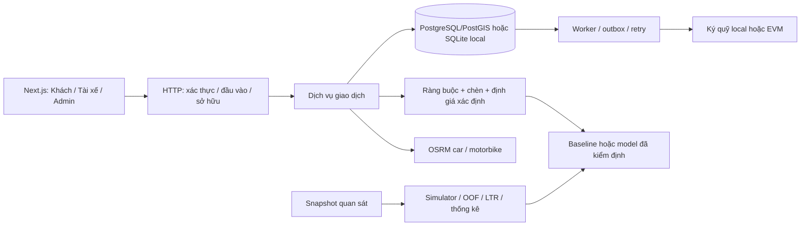

# Phân tích hệ thống và hướng phát triển có kiểm chứng

## 1. Bằng chứng đầu vào và thẩm quyền quyết định

Bốn tệp gốc gồm báo cáo Revision 9, baseline cấu hình, decision register và changelog. Workspace ban đầu không có ứng dụng, dữ liệu bản đồ, hợp đồng Solidity hay dataset khảo sát. [Chỉ mục nguồn](source_inventory.md) ghi 275 đề mục, số dòng, kích thước và SHA-256 của cả bốn tệp; bản gốc được giữ nguyên.

Thứ tự đối chiếu: quyết định được chấp thuận và baseline khóa → đặc tả chi tiết Revision 9 → ví dụ hồi quy → changelog. Baseline là nguồn cấu hình thực thi. Changelog là bằng chứng về lý do sửa, không phải một biểu giá song song. Các tham chiếu đến Revision 8, báo cáo thẩm định và file open-issues không có trong workspace không được giả định là đã đọc.

Phạm vi được chủ dự án xác nhận gồm 14 MUST và toàn bộ 9 SHOULD; chưa deploy. Các COULD không tự động trở thành điều kiện nghiệm thu. KYC mock và ràng buộc xã hội tuy nằm trong SHOULD vẫn là phụ thuộc của các luồng MUST, do đó phải có từ lõi.

## 2. Luận điểm kiến trúc

Modular monolith phù hợp với phạm vi vì việc giữ ghế, chốt kế hoạch, đổi giá và tạo lệnh ký quỹ cần một biên giao dịch thống nhất. Tách microservice sớm sẽ đưa thêm bài toán nhất quán phân tán vào phần vốn đã nhạy về đồng thời. Giao tiếp HTTP chỉ là lớp vận chuyển; luật xác định nằm trong `app/domain`, điều phối giao dịch nằm trong `app/services`, tác vụ bền vững nằm trong PostgreSQL/SQLite và worker.

SQLite dùng `BEGIN IMMEDIATE` để có demo và kiểm thử độc lập hạ tầng. Nó tuần tự hóa ghi trên file và **không đại diện** cho hiệu năng/row-lock của PostgreSQL. Hướng chạy chính của hạ tầng là PostgreSQL/PostGIS, Redis và hai graph OSRM riêng. Một router HTTP lớn đã được tách theo năng lực để giữ ranh giới đọc được và kiểm thử được.

## 3. Mô hình miền và ba loại tính đúng đắn

**Tính khả thi vật lý:** đủ ghế trên từng đoạn; điểm đón trước điểm trả; ETA hợp lệ; giới hạn đi vòng, thời gian ngồi xe, hạn đến; khả năng tương thích xã hội; xe và tài xế đủ điều kiện. Kiểm tra lại cho mọi khách cũ khi chèn mới. Chỉ đi chung có đoạn đường dương giữa hai booking độc lập mới tạo bằng chứng MATCHED.

**Tính đúng đắn kinh tế:** giá nằm trong hai cận, không tăng giá đã bảo vệ, không vượt nghĩa vụ tài chính đã báo, thu nhập tài xế tính trên số thực thu. AI không được quyết định giá hay nới ràng buộc.

**Tính đúng đắn giao dịch:** snapshot bất biến, kiểm tra phiên bản dưới khóa, giữ chỗ theo từng offer, retry không tạo booking hoặc giải ngân trùng. Một phép kiểm tra trước transaction không thay thế được ràng buộc/khóa trong transaction.

Ba trục `ride_status`, `price_status`, `escrow_status` được giữ riêng. Khóa giá không ghi đè việc xe đang chạy. Cổng khởi hành chấp nhận tiền ở DEPOSITED/LOCKED/TOPPED_UP; cổng hoàn tất Pool yêu cầu giá đã khóa; cổng giải ngân yêu cầu hoàn tất và khóa giá.

## 4. Kiểm chứng toán học của giá

### Giá tham chiếu và hai ghế

`PrivateFare` là giá nguyên chiếc taxi cho cả booking. Không nhân hệ số ghế vào P, Quote, Gap, Unmatched hay mục tiêu thu nhập tài xế. Hệ số `1 + 0,35(s−1)` chỉ giảm trọng số nhận tiết kiệm và nâng sàn. Đây là điểm quyết định để booking hai ghế vẫn rẻ hơn thuê riêng chiếc xe.

### Phân bổ

Với từng khách chưa khóa, dùng `f_i(τ)=min(Cap_i,max(Floor_i,P_i−τw_i))`. Nghiệm thỏa tổng chỉ tồn tại khi tổng sàn ≤ chi phí mục tiêu ≤ tổng trần. Chọn τ bằng nội suy giữa các điểm gãy; mã dùng `Fraction`, giữ đẳng thức tổng chính xác trước làm tròn. Cấu hình REJECT từ chối trường hợp tổng chi phí nhỏ hơn tổng sàn.

Điều cần phát biểu chính xác: hệ các bất đẳng thức biên và phương trình tổng nói chung có nhiều vector nghiệm. Quy tắc trọng số/đường cong f_i chọn một vector xác định. τ có thể không duy nhất trên đoạn phẳng nhưng vector giá vẫn xác định. Không nên dùng từ “duy nhất” cho toàn bộ miền khả thi mà bỏ quy tắc lựa chọn.

Sàn áp dụng cho **Fare_exact**, còn Fare_charged được làm tròn xuống bội 1.000. Do đó Fare_charged có thể thấp hơn sàn chính xác dưới 1.000 VND; không được viết thêm một CHECK mâu thuẫn bắt Fare_charged ≥ Floor_exact. Phần lẻ chỉ ghi nhận để kiểm toán, không tạo khoản tiền thật cần thu bù.

### Các vector bắt buộc

| Tình huống | Kết quả xác định |
|---|---|
| Bike 14 km / 35 phút | 81.000; tài xế 64.800 |
| Private nội đô 14 km / 40 phút | 194.000 |
| Pool A+B, PlanFare 248.500 | A 143.000; B 105.000; thu 248.000 |
| Chia thu A+B | tài xế 210.800; nền tảng 29.760; Quỹ 7.440 |
| A hai ghế + B một ghế | A 148.000; B 99.000; Quote A giữ 155.000 |
| A không ghép do thị trường | thu 174.000; Quỹ bù 7.300; tài xế 155.200 |
| Tài xế phá ghép | A chỉ trả 155.000; không có trợ giá |
| Private liên tỉnh 65 km | 637.000; tài xế 541.450 |
| Ghế liên tỉnh tham chiếu | 200.000; biên 180.000–220.000 |
| Hai ghế góp thêm | 318.000/ghế; thu 636.000; tài xế 540.600 |

Cổng thu nhập/giờ chạy **sau làm tròn**, trên `0,85 × ΣFare_charged`. Cổng này có thể loại một kế hoạch vốn thỏa sàn/trần; tính khả thi giá không tự chứng minh lợi ích tài xế.

## 5. Chèn động và tính bất biến

Giữ nguyên prefix đã đi, bắt đầu phần còn lại tại vị trí xe hiện tại và cộng quãng đường đã chở từng khách. Kiểm tra D1–D6: kế hoạch còn mở, có đồng hành thật; đóng băng khách khóa; trần động cho khách chưa khóa; khả thi cả sàn lẫn trần trên phần chi phí còn lại; kiểm tra kinh tế sau làm tròn; kiểm tra trần ngân sách khách mới.

Nhóm đã khóa được trừ bằng giá chính xác cũ khỏi mục tiêu phân bổ, trong khi tiền thu của nhóm đó giữ nguyên final đã làm tròn. Trộn hai đại lượng này sẽ phá đẳng thức tổng và có thể thu tăng tiền đã khóa.

Phần online và Simulator dùng chung engine chèn/định giá. Kết quả mẫu trong tài liệu là vector hồi quy, không phải kết quả OSRM đã đo ngoài thực địa. Tọa độ/vùng minh họa cần một phiên bản dữ liệu được kiểm định trước khi dùng làm chuẩn thực nghiệm địa lý.

## 6. Đồng thời, job và ký quỹ

Idempotency gắn với `(user, key, route+payload hash)`. Cùng key và nội dung trả lại kết quả; khác nội dung trả 422. Ứng viên cũ bị từ chối dưới khóa thay vì tin vào bản đọc trước transaction. `populate_existing` bảo đảm ORM không giữ bản cũ sau khi đã chờ khóa.

Mỗi bước offer có hold riêng 35s nội đô / 75s liên tỉnh. Khi hết hạn, hold cũ được giải phóng rồi mới giữ xe tiếp theo, luôn cùng dịch vụ. Các bài thử bao gồm nhận ở giây thứ 59 của chuỗi ba bước.

Lệnh ký quỹ là outbox có operation ID ổn định, sequence và predecessor. Quan hệ phụ thuộc này cần thiết vì nhiều lệnh có thể cùng timestamp; sắp xếp theo timestamp rồi UUID không đủ bảo đảm START → LOCK/COMPLETE → RELEASE. Adapter lưu journal trước broadcast, retry cùng lệnh không thanh toán lần hai.

Giao dịch ngoài DB không thể trở thành một transaction ACID chung với DB. Vì vậy receipt xác nhận được áp dụng lại an toàn sau crash; webhook HMAC chỉ là tín hiệu đánh thức, không được tự khẳng định tiền đã tới. Quỹ thiếu thanh khoản làm giải ngân thất bại nguyên tử và tạo retry/cảnh báo; không ghi payout thành công giả. Bảo đảm thu nhập dài hạn vẫn cần quản trị thanh khoản và kiểm định mật độ nhu cầu.

## 7. Liên tỉnh và các điểm cần thống nhất

Đóng đặt tại T−72h; đủ ngưỡng thì chạy, thiếu ngưỡng lần lượt thử gộp, góp thêm tự nguyện, rồi tài xế quyết định trước T−60h. Gộp chỉ giảm/giữ giá và có hai giờ hủy miễn phí. Không gộp vào một chuyến đang tài trợ topup dở dang. Hủy sau khi chuyến xác nhận không tự động hủy những khách còn lại.

Góp thêm phải được tất cả booking đồng ý trước khi gửi lệnh nạp thêm. Phí chuyển sang 15% theo bản chất bao xe chia tiền. Adapter có lệnh hoàn lại phần topup để hỗ trợ bù trừ khi funding không hoàn tất; các job thất bại phải được theo dõi đến một kết cục đã đối soát.

Tối ưu thứ tự đón/trả dùng vét cạn trên tối đa 576 chuỗi, dùng một ma trận chung. Không chờ đến T−24h mới phát hiện một booking mới làm sai khung giờ khách cũ: phép nhận booking và phép sinh ứng viên cũng phải kiểm tra lộ trình chung.

S4 được thực hiện trên bundle RTV đã kiểm tra đồng thời; không cộng hai cạnh chèn độc lập. Backend hiện chỉ di chuyển offer Pool HELD chưa được nhận và chưa ký quỹ, tránh đổi tài xế của một booking đã nhận tiền mà không có giao thức chuyển ký quỹ tương ứng. Phạm vi thực thi và trần ma trận/admission này phải được giữ trong benchmark, không gán kết quả cho toàn bộ 500 yêu cầu tùy ý.

## 8. Chiến lược khoa học cho AI

Giả thuyết H1/H2/H3/H9 là câu hỏi cần kiểm định, không phải điều kiện ép kết quả dương. Dùng split thời gian theo query, embargo các outcome chưa quan sát được, 5-fold OOF cho P(match) và P(fulfill) khi dùng làm feature. Huấn luyện classifier và calibration trong phần dữ liệu hợp lệ; giữ Test ngoài fitting.

Xếp hạng theo điểm LTR thô khi chưa đủ cổng hiệu chỉnh. Nhân P(select) × P(fulfill) chỉ sau cổng ECE và có bằng chứng cho các xác suất thành phần. Thiếu nhãn/nhãn một lớp thì dùng prior và báo thiếu bằng chứng, không gọi đó là một mô hình đã được xác nhận.

So sánh 2×2: tuyến tính/cây × thô/tương tác. Báo tách nội đô một người đa phương tiện, nhóm/hành lý, liên tỉnh và thời tiết. Bootstrap/permutation dùng cặp hoặc seed phù hợp; chạy closed-loop bằng Common Random Numbers để thay chính sách không làm thay dòng nhu cầu ngoại sinh.

Khảo sát S1 cần 100–200 người, sinh viên và người đi làm mỗi nhóm 40–60%. Instrument, thu thập ẩn danh, GroupKFold theo respondent, Friedman/Wilcoxon có hiệu chỉnh đa so sánh đã có mã; **chưa có người trả lời thật trong workspace**, nên H4 và kiểm định người thật chưa hoàn tất. Không thay bằng phản hồi tự sinh.

## 9. Hướng đi ưu tiên sau bản local

1. Chốt vùng phục vụ có nguồn gốc và phiên bản; dựng PostgreSQL/PostGIS, Redis, hai graph OSRM; chạy cùng bộ kiểm thử đồng thời trên PostgreSQL.
2. Hiệu chỉnh profile motorbike bằng các cặp điểm chuẩn V-03; đo số lần gọi ma trận, p95, hủy/offer và worker ở quy mô Mục 77.
3. Chạy main benchmark và phân tích độ nhạy Quỹ theo mật độ, mưa và chính sách; chỉ kết luận hòa vốn từ quần thể nhất quán. Tách tỷ lệ theo booking khỏi theo ride.
4. Thu S1 có đồng ý tham gia; hiệu chỉnh phân phối hành vi, rồi đánh giá lại H1/H2/H3/H9 và các SHOULD trên dữ liệu độc lập.
5. Sau khi chủ dự án chọn deploy: cấu hình HD wallet/relayer, cấp tín dụng thử nghiệm, kiểm tra chain/ABI/finality, chạy lại đối soát trên testnet. Không dùng dữ liệu hoặc khóa demo cho vận hành thật.

## 10. Nguồn kỹ thuật đối chiếu

Giao dịch/dependency dựa trên [FastAPI](https://fastapi.tiangolo.com/tutorial/dependencies/dependencies-with-yield/) và [SQLAlchemy Session](https://docs.sqlalchemy.org/en/20/orm/session_api.html). Giới hạn SQLite được đối chiếu với [tài liệu dialect](https://docs.sqlalchemy.org/en/20/dialects/sqlite.html). Kiến trúc UI theo [Next.js App Router](https://nextjs.org/docs/app/getting-started). Giao thức ma trận/profile theo [OSRM API](https://project-osrm.org/docs/v5.24.0/api/) và [profile car chính thức](https://github.com/Project-OSRM/osrm-backend/blob/v5.27.1/profiles/car.lua). Dữ liệu OSM có thể lấy từ [Geofabrik Việt Nam](https://download.geofabrik.de/asia/vietnam.html). Các văn bản pháp lý trong đặc tả không được coi là giấy phép vận hành; dự án hiện là nguyên mẫu nghiên cứu theo phạm vi đã chốt.
